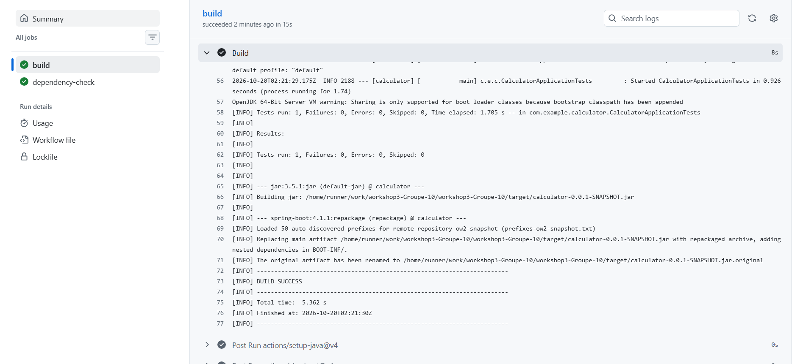
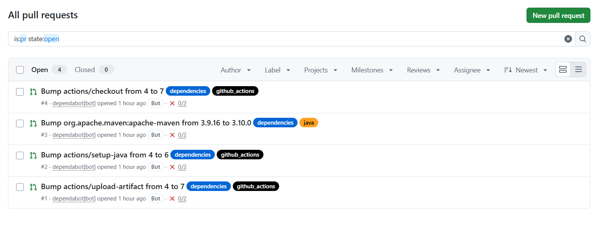
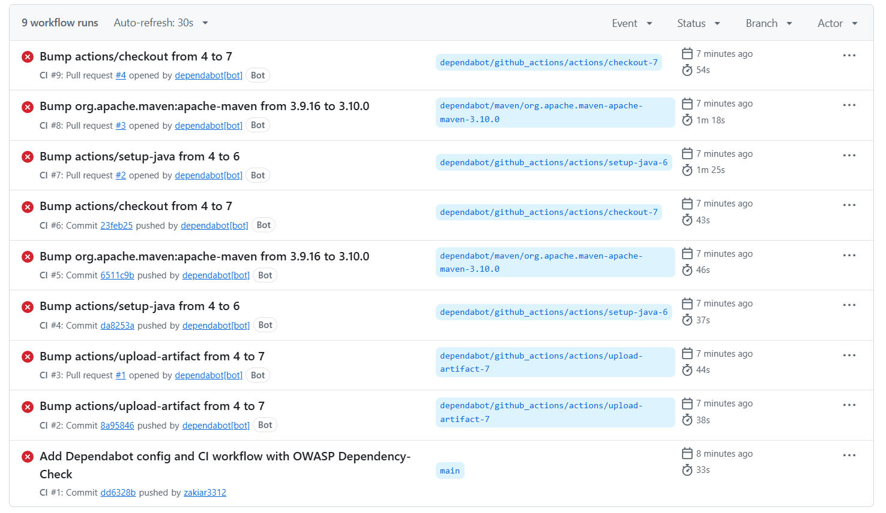
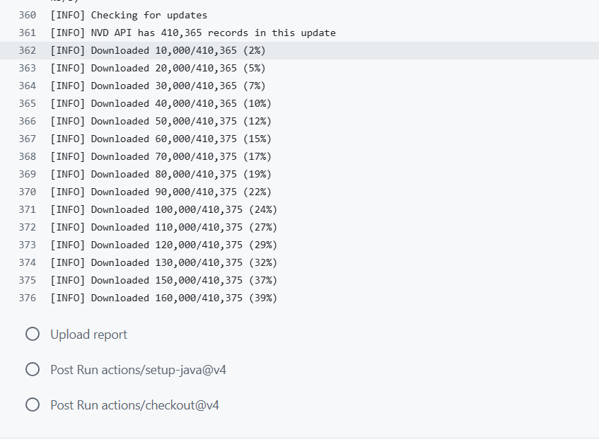
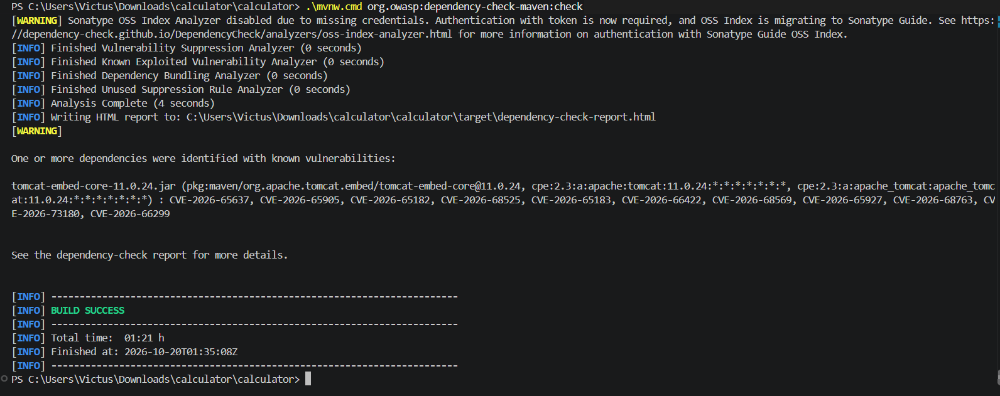
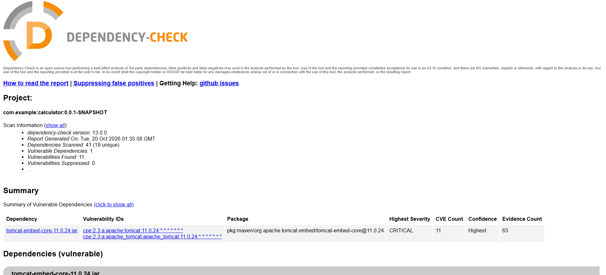
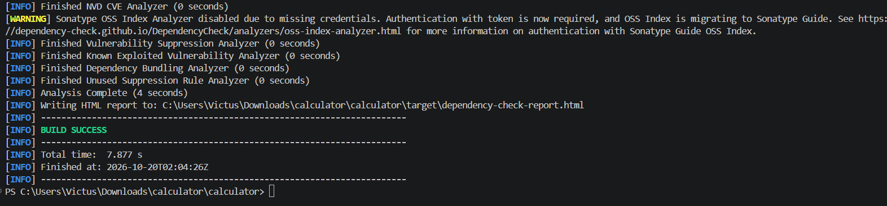
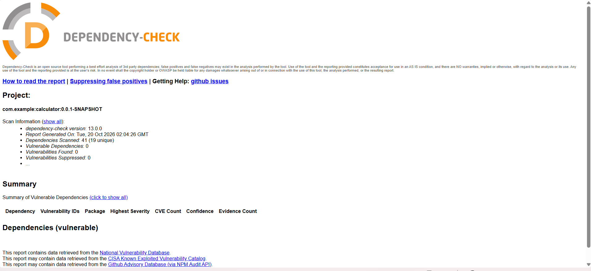
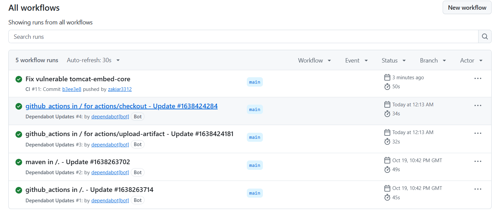
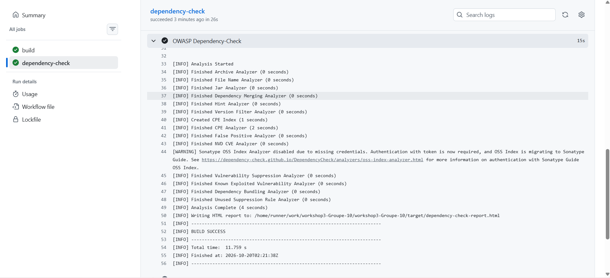

# Workshop 3 – Sécurité des dépendances (Dependabot & OWASP Dependency-Check)

**Groupe :** 10
**Membres :** Zakaria Aribi , Zakaria Mouada , Jihane Diouri

## 1. Objectif
Sécuriser les dépendances d'un projet Maven (Spring Boot) avec Dependabot pour les mises à jour automatiques et OWASP Dependency-Check pour la détection des vulnérabilités, le tout intégré dans un pipeline CI/CD GitHub Actions.

## 2. Compilation du projet
Le projet compile sans erreur (1 test, 0 échec).



## 3. Configuration de Dependabot
Fichier `.github/dependabot.yml` : surveillance des dépendances Maven (quotidienne) et des GitHub Actions (hebdomadaire).

```yaml
version: 2
updates:
  - package-ecosystem: "maven"
    directory: "/"
    schedule:
      interval: "daily"
    open-pull-requests-limit: 5
  - package-ecosystem: "github-actions"
    directory: "/"
    schedule:
      interval: "weekly"
```

Dependabot a ouvert automatiquement des Pull Requests de mise à jour :



## 4. Pipeline CI/CD
Le workflow `.github/workflows/ci.yml` contient deux jobs :
- `build` : compilation et tests (`mvn clean verify`) ;
- `dependency-check` : analyse OWASP Dependency-Check avec la clé API NVD stockée dans les secrets GitHub, cache de la base NVD et publication du rapport en artefact.




Le secret a ensuite été configuré. Le premier téléchargement de la base NVD (plus de 410 000 enregistrements) a pris plus d'une heure, d'où l'ajout d'un cache pour accélérer les exécutions suivantes.



## 5. Détection de la vulnérabilité
Le scan a détecté une dépendance vulnérable : `tomcat-embed-core 11.0.24` (11 vulnérabilités, sévérité CRITICAL).




## 6. Correction
La version de Tomcat a été mise à jour via la propriété `<tomcat.version>` dans le `pom.xml`.

Après correction : 41 dépendances analysées, **0 vulnérabilité**.




## 7. Résultat dans le pipeline
Le pipeline s'exécute avec succès (jobs `build` et `dependency-check`).




## 8. Conclusion
Dependabot maintient les dépendances à jour automatiquement en ouvrant des Pull Requests, et OWASP Dependency-Check analyse les bibliothèques à chaque push pour signaler ou bloquer celles qui sont vulnérables. Ensemble, ces outils détectent les risques tôt dans le pipeline CI/CD et permettent de les corriger avant la mise en production.
